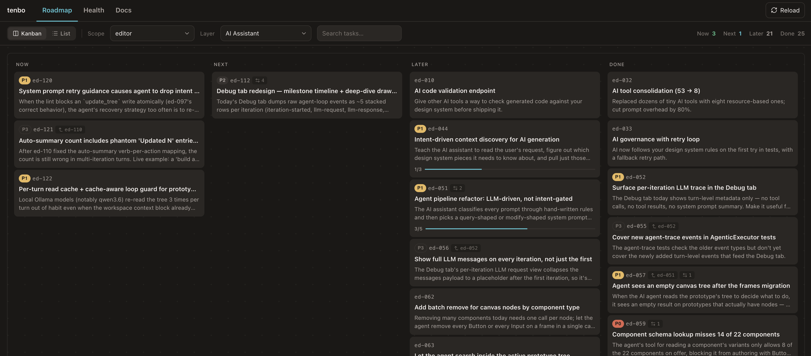
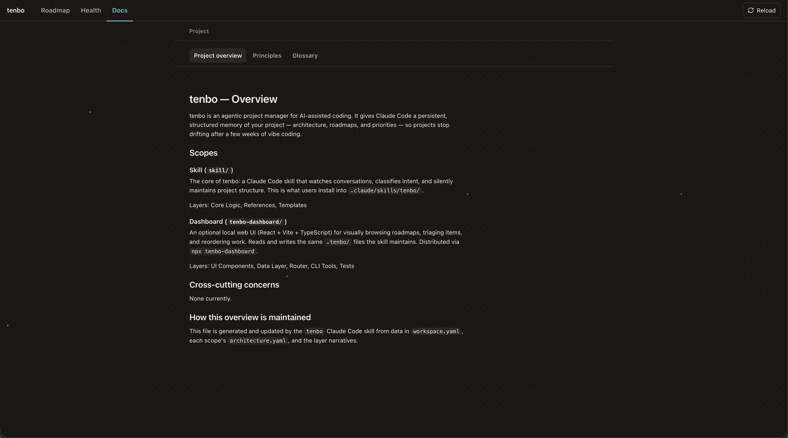
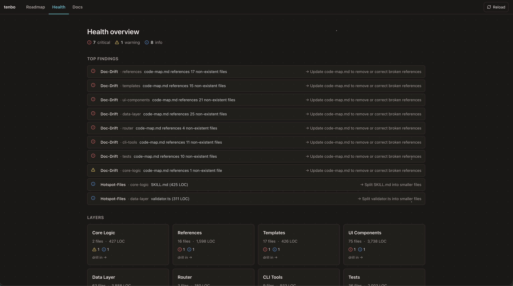

# tenbo-dashboard

Local architecture dashboard and CLI tools for [tenbo](https://github.com/poyi/tenbo) — an agentic project manager for AI-assisted coding.

## Quick start

```bash
# Run in any project with a .tenbo/ directory
npx tenbo-dashboard
```

Opens a local dashboard at http://localhost:5174.

## What it gives you

Three views over the same `.tenbo/` files Claude maintains. Edits in either surface show up in the other on next refresh.

### Roadmap — what to work on next



Kanban across `now` / `next` / `later` / `done`, grouped by scope and layer. Drag to reprioritize, click to edit. The same roadmap Claude reads when you ask "what should I build next?".

### Docs — what the project actually does



Project overview, principles, and glossary alongside per-layer narratives, intents (responsibilities + boundaries + invariants), and code maps (entry points + key files + extension recipes). Onboard new contributors — human or AI — in minutes instead of an hour of grep.

### Health — where the codebase is quietly rotting



Surfaces the things that would otherwise become tech debt nobody mentions: oversized layers (hotspots), code-map references that no longer match real files (doc drift), unreferenced files, coupling violations, dead code. Each finding carries a severity, the file it points at, and a suggested fix.

Some health findings include generated graph evidence such as importers, exports,
and layer ownership. This evidence is rebuilt from source and `.tenbo/` metadata;
it is not separate project memory.

## CLI tools

The same package ships commands the skill uses behind the scenes — also runnable directly:

```bash
npx tenbo-dashboard item show sk-030 --json
npx tenbo-dashboard item allocate-id sk --json
npx tenbo-dashboard item create sk-031 --scope skill --title "Add a command" --description "Expose the command through the typed backend."
npx tenbo-dashboard item update sk-031 --patch '{"done_when":["Command is covered by tests."]}'
npx tenbo-dashboard item set-status sk-030 done
npx tenbo-dashboard item add-note sk-030 "Implemented; live verification pending"
npx tenbo-dashboard item verify sk-030 --status pending_live --evidence "npm test -- --run"
npx tenbo-dashboard item link-commit sk-030 7fc09a5
npx tenbo-dashboard item claim sk-031 --owner agent-a --lease 900
npx tenbo-dashboard item document-create sk-031 --kind spec --slug command --content-file /tmp/sk-031.md
npx tenbo-dashboard items --status done --verification pending_live --json
npx tenbo-dashboard next --json
npx tenbo-dashboard context feature --query "help me build X" --json
npx tenbo-dashboard impact --json     # Map git changes to affected layers/docs/items
npx tenbo-dashboard index --json      # Rebuild the derived source index
npx tenbo-dashboard validate          # Schema + consistency checks
npx tenbo-dashboard init-check        # Strict completeness check after fresh init
npx tenbo-dashboard metrics --all     # Recompute scope metrics + health findings
npx tenbo-dashboard next-id <prefix>  # Allocate next roadmap item ID
npx tenbo-dashboard --version         # Print the installed version
```

Installed packages also expose a shorter `tenbo` binary alias for the same commands.

`context feature` is the agent-facing read path. It returns likely scope/layers,
matching roadmap items, active work, goal refs, recommended files, and freshness warnings
as one JSON payload so agents do not have to re-read every roadmap file by hand.

The package exposes one transport-neutral contract to the browser and CLI, with
small item, context, coordination, planning-document, and project ports. Local
projects use `LocalTenboBackend`; hosted deployments inject a typed
`CloudTenboBackend` gateway. Browser modules never import filesystem storage.

### Cloud backend and migration

Cloud mode is explicit. When configured, supported item commands plus
`items`, `next`, `work-queue`, `context`, and `next-id` use the cloud gateway
exclusively; a failed cloud write never falls back to roadmap YAML.

After cutover, `.tenbo/cloud-project.json` declares the canonical project,
backend epoch, schema, and minimum CLI version. Tenbo 0.14+ validates that
pointer before every route. A private repository may include a
`repository_agent_token` when repository read access is intentionally the
authorization boundary; this makes trusted agent checkouts work with no
machine-specific setup. The token must be a single-project editor capability,
never a Supabase key or Tenbo administrator credential.

Explicit environment or external-profile credentials override the repository
capability. Without either form, a canonical pointer fails closed and never
revives the legacy file backend. External profiles are loaded from
`${XDG_CONFIG_HOME:-~/.config}/tenbo/<profile>.json` and must be chmod 600.

Provide non-secret endpoint identity and exactly one human or agent credential
through the process environment:

```sh
export TENBO_CLOUD_API_URL="https://<project>.supabase.co/functions/v1/tenbo-api"
export TENBO_CLOUD_PROJECT_ID="<tenbo-project-uuid>"
export TENBO_CLOUD_ANON_KEY="<supabase-anon-or-publishable-key>"
export TENBO_CLOUD_AGENT_TOKEN="<opaque-project-agent-token>"
# Dashboard/browser sessions use TENBO_CLOUD_HUMAN_JWT instead of the agent token.
```

Alternatively set `TENBO_CLOUD_CREDENTIALS_FILE` to an external chmod-600 JSON
file (it is rejected when stored inside the repository):

```json
{
  "api_url": "https://<project>.supabase.co/functions/v1/tenbo-api",
  "project_id": "<tenbo-project-uuid>",
  "anon_key": "<supabase-anon-or-publishable-key>",
  "agent_token": "<opaque-project-agent-token>"
}
```

Migration and recovery commands are deterministic and write-single:

```sh
tenbo-dashboard cloud manifest --output /restricted/tenbo-manifest.json
tenbo-dashboard cloud import --manifest /restricted/tenbo-manifest.json
# Final one-time cutover: exact roadmap/planning replacement while preserving
# trusted Git projections and cloud-native audit history.
tenbo-dashboard cloud import --manifest /restricted/tenbo-manifest.json --replace
tenbo-dashboard cloud compare --manifest /restricted/tenbo-manifest.json
tenbo-dashboard cloud shadow-read --kind item --item x-093
tenbo-dashboard cloud benchmark --fixture /path/to/cloud-roadmap-v1.benchmark.json
tenbo-dashboard cloud export --output /restricted/tenbo-recovery.json
tenbo-dashboard cloud restore --input /restricted/tenbo-recovery.json --confirm-project <uuid>
```

Recovery exports retain every mutation's exact actor, request/result,
committed versions, and audit classification. Recovery replacement is distinct
from roadmap cutover replacement and remains an explicit admin-only operation.

Trusted Git projections never accept document content as a CLI argument. The
tool requires a full commit SHA, obtains exact bytes with `git show
<sha>:<path>`, verifies repository identity and SHA-256, then invokes the
existing server-authorized ingestion command (editor or admin). Destination
identity comes from the project-scoped `getProjectIdentity` query, returning only
`id` and `repository`; ingestion never calls `exportProject`. Project authentication
and the server's repository/path/hash checks remain mandatory. Export, import,
recovery, and promotion finalization retain their privileged permissions.
Explicit environment/external-profile credentials still override a repository
capability. Missing identity, unsupported gateways, and authorization failures
stop the command without export retries or local planning fallbacks:

```sh
tenbo-dashboard cloud ingest-git --commit <full-sha> --path .tenbo/overview.md
tenbo-dashboard cloud dirty-overlay --commit <full-sha> --path .tenbo/overview.md
```

### Upgrade from 0.15.2-cloudfix.4

The versioned CLI artifact is `tenbo-dashboard-0.15.2-cloudfix.5.tgz`.
Deploy the matching Tenbo gateway first: it must support `getProjectIdentity`
and capability matrix v2 (editor Git ingestion, privileged export unchanged).
No database migration or credential rotation is required. Older gateways fail
closed; upgrading only the CLI is insufficient.

For Ionic-design-system's vendored pin, copy the artifact to `vendor/`, change
`devDependencies.tenbo-dashboard` to
`file:vendor/tenbo-dashboard-0.15.2-cloudfix.5.tgz`, then run `pnpm install` and
commit the artifact, package manifest, and lockfile together. Verify the installed
package version before rerunning the pending sync:

```sh
node -p "require('tenbo-dashboard/package.json').version"
npx tenbo-dashboard cloud ingest-git --commit <full-sha> --path AGENTS.md --json
git show <full-sha>:AGENTS.md | shasum -a 256
npx tenbo-dashboard context feature --query 'AGENTS.md' --json
```

Compare `document.content_hash` with the exact `git show` byte hash and verify
that context returns the expected document path. Do not use a worktree-file hash:
committed bytes may differ. Keep sync incomplete on any API/hash/retrieval failure.

## What is tenbo?

An AI cofounder that gives your coding assistant persistent project memory — architecture docs, roadmaps, and health signals that survive across sessions. Available as a Claude Code skill and as a Cursor rule package; both editors share the same `.tenbo/` data and the same companion dashboard. The dashboard is the optional visual companion; the skill / rule is the always-on conversational brain.

Install: [github.com/poyi/tenbo](https://github.com/poyi/tenbo) (instructions for both Claude Code and Cursor)

## License

MIT
